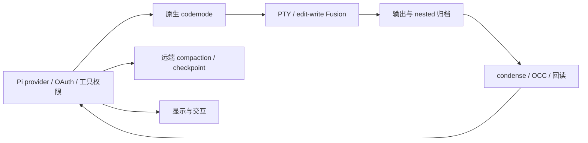

# 架构与所有权

根 `package.json` 管依赖、入口和交付。Pi 加载 `extensions/*.ts`、主题和 skills，拿着模型、认证、工具权限和原生 codemode；Metis 只管自己功能的状态和资源。

## 入口和模块

| 入口 | 实现与职责 |
| --- | --- |
| `appearance.ts` | `src/appearance/`：宿主适配、转录、输入、状态、复制、诊断。 |
| `skill-mux.ts` / `skill-entry.ts` | `src/skills/`：多 skill 展开、补全、折叠；资源发现归 Pi。 |
| `goal.ts` | `src/goal/`：目标、计时、用量、交互、续跑。 |
| `dynamic-agents.ts` | `src/dynamic-agents/`：按模型选全局指令，run 边界发布。 |
| `system-prompt.ts` | 把 Pi `docs` 段指向 agent 目录指引，保留用户原有的自定义提示。 |
| `retry-policy.ts` | 瞬时计费查询失败分类；重试次数、退避和取消归 Pi。 |
| `condense.ts` | `src/condense/`：归档、精简、恢复、摘要、OCC。 |
| `codex-compaction.ts` | `src/remote-compaction/`：远端检查点、跨模型摘要、压缩请求归属。 |
| `action-fusion.ts` | `src/execution/action-fusion.ts`：`then_run`、路径队列、修改回执。 |
| `execution.ts` | `src/execution/`：PTY 会话、后台 shell、进程清理。 |
| `mcp.ts` | `src/mcp/`：目录缓存、连接、会话租约；协议、认证、CLI 复用 Pi 的。 |
| `subagents.ts` | `src/subagents/`：父端 UI 和接收、Python 账本和调度、JS SDK worker。 |
| `neural-search.ts` | `src/neural-search/`：本地索引、Rust 引擎、查询、分页、文件补全。 |
| `web-access.ts` / `session-recall.ts` | `src/pi-web-access/` / `src/pi-session-recall/`：deferred 网页和会话查询。 |
| `ask-user-question.ts` | `src/ask-user-question/`：结构化决策问卷。 |
| `lsp.ts` | `src/pi-lsp/`：服务器路由、诊断、单文件 source action。 |
| `config.ts` | 全局配置路径和初始化。 |

`configuration/store.ts` 负责加锁、合并、原子写；各功能模块负责自身字段的校验和生效，见[配置](configuration.md)。

## 显示数据流

宿主事件 → 功能状态/度量 → 快照 → 渲染。

- `appearance/` 适配主会话和宿主组件；遇到陌生结构或已被外来代码接管时回退原生行为。
- `presentation/` 放主转录和子代理共用的工具、Diff、Shell、思考、预览组件。
- `file-changes/` 存文件快照和修改证据；显示观察和执行回执各归调用方。
- `selection-copy/` 从已提交帧的来源映射提取逻辑原文；映射缺失的部分走原生提取。
- 计时、Git 轮询、用量采样分别管理生命周期；动画帧只做渲染，I/O 归各自 owner。

显示层只改呈现，执行、结果、图片和模型正文始终来自 Pi。codemode 包装只绑父调用上下文，沙箱 helper 回调执行真实动作；包装留下有界的动作元数据，供复制和回放使用。
`searchTools` 摘要显示实际返回数量，独立展开时列出至多八个工具名，不复制描述或类型声明；旧记录缺少动作元数据时保留通用脚本摘要，不从源码猜执行结果。
包装和观察按租约释放，切会话时先让晚到的任务失效。

## 执行与上下文

| 边界 | 所有权 |
| --- | --- |
| 执行 | helper 持有进程输出、退出和关闭，TS manager 管等待、交付、显示。归档缺失部分时保留原因和真实退出码。 |
| 精简 | 原文、候选、发布表示分开存；保护、错误、未完成、归档失败都会拦下不安全的替换。OCC 和远端压缩协商同一次请求，见 [condense](features/condense.md)、[远端压缩](features/codex-compaction.md)。 |
| MCP | 每个服务器一个会话 owner；缓存只做目录，调用照样走 Pi 事件和权限。 |
| 网页 | adapter 管协议和计费，transport 把代理限定在 Web 请求并校验 DNS/SSRF；读 Cookie 要授权，Curator 管审阅 UI 和会话。 |
| 子代理 | Runtime 推任务，worker 跑 run；账本、结果、接收票据管恢复和确认。前端断开只是显示中断，任务照常运行，见[生命周期](subagents/lifecycle.md)。 |

跨扩展协作契约在 `src/collaboration.ts`；子代理内部分工见[目录说明](../src/subagents/README.md)。

## 生命周期与交付

配置、恢复证据、显示缓存寿命各自独立：丢失缓存时 blobs 仍在，卸载显示层时领域任务继续运行。取消、锁、提交、关闭各归其 owner。

安装带随包 TS、Web bundle、子代理核心、原生资产、主题、skills、许可，以及需要手动应用的 SDK 补丁；原生源码、构建工具、测试留 Git。流程见[开发](development.md)，来源见[执行说明](provenance/execution/README.md)和 [NOTICE](../NOTICE)。
