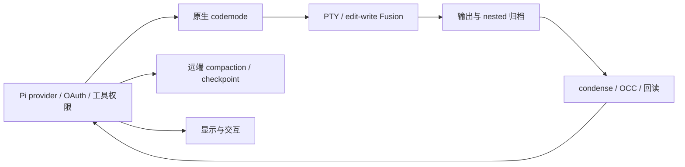

# 架构与所有权

根 `package.json` 管理依赖、入口与交付。Pi 加载 `extensions/*.ts`、主题和 skills，并持有模型、认证、工具权限及原生 codemode；Metis 按功能管理自己的状态与资源。

## 入口和模块

| 入口 | 实现与职责 |
| --- | --- |
| `appearance.ts` | `src/appearance/`：宿主适配、转录、输入、状态、复制、诊断。 |
| `skill-mux.ts` / `skill-entry.ts` | `src/skills/`：多 skill 展开、补全、折叠；资源发现归 Pi。 |
| `goal.ts` | `src/goal/`：目标、计时、用量、交互、续跑。 |
| `dynamic-agents.ts` | `src/dynamic-agents/`：按模型选择全局指令，在 run 边界发布。 |
| `system-prompt.ts` | 将 Pi `docs` 分段指向 agent 目录指引，保留完整自定义提示。 |
| `retry-policy.ts` | 分类瞬时计费查询故障；重试次数、退避、取消归 Pi。 |
| `condense.ts` | `src/condense/`：归档、精简、恢复、摘要、OCC。 |
| `codex-compaction.ts` | `src/remote-compaction/`：远端检查点、跨模型摘要、压缩请求所有权。 |
| `action-fusion.ts` | `src/execution/action-fusion.ts`：`then_run`、路径队列、修改回执。 |
| `execution.ts` | `src/execution/`：PTY 会话、后台 shell、进程清理。 |
| `mcp.ts` | `src/mcp/`：目录缓存、连接、会话租约；复用 Pi 协议、认证、CLI。 |
| `subagents.ts` | `src/subagents/`：父端 UI/接收、Python 账本/调度、JS SDK worker。 |
| `neural-search.ts` | `src/neural-search/`：本地索引、Rust 引擎、查询、分页、文件补全。 |
| `web-access.ts` / `session-recall.ts` | `src/pi-web-access/` / `src/pi-session-recall/`：deferred 网页与会话查询。 |
| `ask-user-question.ts` | `src/ask-user-question/`：结构化决策与问卷。 |
| `lsp.ts` | `src/pi-lsp/`：服务器路由、诊断、单文件 source actions。 |
| `config.ts` | 全局配置路径与初始化。 |

`configuration/store.ts` 负责加锁、合并、原子写入；功能模块负责字段校验和生效策略，见[配置](configuration.md)。

## 显示数据流

宿主事件 → 功能状态/度量 → 快照 → 渲染。

- `appearance/` 适配主会话与宿主组件，遇未知结构或外来接管时退避。
- `presentation/` 提供主转录/子代理共用的工具、Diff、Shell、思考与预览组件。
- `file-changes/` 持有文件快照和修改证据；显示观察与执行回执由各调用方管理。
- `selection-copy/` 从已提交帧的来源映射提取逻辑原文，未知区域回退原生。
- 计时、Git 轮询与用量采样各自管理生命周期；动画帧不扫描历史、读磁盘或查额度。

显示不改原生执行、结果、图片或模型正文。codemode 包装只绑定父调用上下文，沙箱 helper 回调提供真实动作；仅保留有界动作元数据，不复制完整返回值或解析源码猜调用。包装/观察按租约释放，会话切换先使晚到任务失效。

## 执行与上下文

| 边界 | 所有权 |
| --- | --- |
| 执行 | helper 持有进程输出/退出/关闭；TS manager 管理等待、交付、显示。归档不完整时保留原因和真实退出码。 |
| 精简 | 原文、候选、发布表示分离；保护、错误、未完成或归档失败阻止不安全替换。OCC/远端压缩协商同一次请求，见 [condense](features/condense.md)、[远端压缩](features/codex-compaction.md)。 |
| MCP | 每服务器一个会话 owner；缓存只供目录，调用仍走 Pi 事件与权限。 |
| 网页 | adapter 管协议/计费，transport 将代理限定于 Web 请求并校验 DNS/SSRF；Cookie 读取须授权，Curator 管审阅 UI/会话。 |
| 子代理 | Runtime 推进任务，worker 执行 run；账本/结果/接收票据负责恢复与确认，前端断开不等于停止，见[生命周期](subagents/lifecycle.md)。 |

跨扩展协作合同归 `src/collaboration.ts`；子代理内部划分见[目录说明](../src/subagents/README.md)。

## 生命周期与交付

配置、恢复证据、显示缓存寿命独立：丢缓存不删 blobs，卸载显示不停止领域任务。各 owner 负责取消、锁、提交和关闭。

安装使用随包 TS、Web bundle、子代理核心、原生资产、主题、skills 与许可；原生源码、构建工具和测试留在 Git。流程见[开发](development.md)，来源见[执行说明](provenance/execution/README.md)与 [NOTICE](../NOTICE)。
