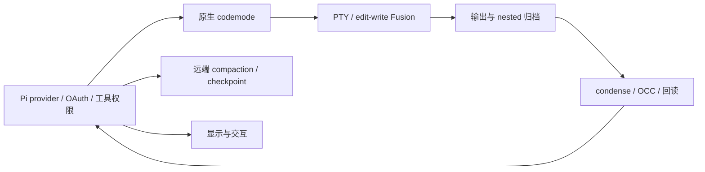

# 架构与所有权

根 `package.json` 管理依赖、入口和交付物。Pi 负责加载 `extensions/*.ts`、主题和 skills，并持有模型、认证、工具权限和原生 codemode。Metis 只管理自己功能的状态与资源。

## 入口与模块

| 入口 | 实现与职责 |
| --- | --- |
| `appearance.ts` | `src/appearance/`：宿主适配、转录、输入、状态、复制、诊断。 |
| `skill-mux.ts`、`skill-entry.ts` | `src/skills/`：多 skill 展开、补全与折叠。资源发现归 Pi。 |
| `goal.ts` | `src/goal/`：目标、计时、用量、交互与续跑。 |
| `dynamic-agents.ts` | `src/dynamic-agents/`：按模型选择全局指令，在 run 边界发布。 |
| `system-prompt.ts` | 把 Pi 的 `docs` 段指向 agent 目录的指引，保留用户原有的自定义提示。 |
| `retry-policy.ts` | 瞬时计费查询失败的分类。重试次数、退避和取消归 Pi。 |
| `condense.ts` | `src/condense/`：归档、精简、恢复、摘要与 OCC。 |
| `codex-compaction.ts` | `src/remote-compaction/`：远端检查点、跨模型摘要与压缩请求归属。 |
| `action-fusion.ts` | `src/execution/action-fusion.ts`：`then_run`、路径队列与修改回执。 |
| `execution.ts` | `src/execution/`：PTY 会话、后台 shell 与进程清理。 |
| `mcp.ts` | `src/mcp/`：目录缓存、连接与会话租约。协议、认证和 CLI 复用 Pi 的实现。 |
| `subagents.ts` | `src/subagents/`：父端 UI 与接收、Python 账本和调度、JS SDK worker。 |
| `neural-search.ts` | `src/neural-search/`：本地索引、Rust 引擎、查询、分页与文件补全。 |
| `web-access.ts`、`session-recall.ts` | `src/pi-web-access/`、`src/pi-session-recall/`：deferred 网页与会话查询。 |
| `ask-user-question.ts` | `src/ask-user-question/`：结构化决策问卷。 |
| `lsp.ts` | `src/pi-lsp/`：服务器路由、诊断与单文件 source action。 |
| `config.ts` | 全局配置路径与初始化。 |

`configuration/store.ts` 负责加锁、合并与原子写入。各功能模块负责校验并生效自身字段，见[配置](configuration.md)。

## 显示数据流

宿主事件经功能状态和度量进入快照，再由渲染层读取。

- `appearance/` 适配主会话和宿主组件。遇到不认识的结构，或宿主组件已被外部代码接管时，回退到原生行为。
- `presentation/` 放主转录和子代理共用的工具、Diff、Shell、思考和预览组件。
- `file-changes/` 保存文件快照和修改证据。显示观察和执行回执分别由各自的调用方记录。
- `selection-copy/` 从已提交帧的来源映射中取出逻辑原文。映射缺失的部分交给原生提取。
- 计时、Git 轮询和用量采样各自管理生命周期。动画帧只负责渲染，I/O 归各自的 owner。

显示层只改变呈现。执行结果、图片和模型正文始终来自 Pi。codemode 包装只绑定父调用上下文，沙箱 helper 的回调执行真实动作。包装会留下有界的动作元数据，供复制和回放使用。

[统一发现](features/tool-discovery.md)由 Metis 的 `tool_search` 插件读取 Pi 的实时目录。直接调用和 codemode 共用参数、结构化结果与工具自身的 renderer。旧的 `searchTools` 动作记录仍可回放；有界的名称摘要不复制类型声明。缺少元数据时，显示通用的脚本摘要，不从源码推断执行结果。包装与观察按租约释放，切换会话时先让晚到的任务失效。

## 执行与上下文

| 边界 | 所有权 |
| --- | --- |
| 执行 | helper 持有进程输出、退出与关闭；TS manager 管理等待、交付与显示。归档缺失部分时，保留原因和真实退出码。 |
| 精简 | 原文、待整理内容和已发布结果分开保存。替换前检查来源、保护规则、消费状态、归档完整性和收益。同一次压缩只由一个入口负责，OCC 与远端入口不会重复生成摘要。见 [condense](features/condense.md)、[远端压缩](features/codex-compaction.md)。 |
| MCP | 每个服务器一个会话 owner。缓存只保存目录，调用仍走 Pi 的事件与权限。 |
| 网页 | adapter 管协议与计费；transport 把代理限定在网页请求内，并校验 DNS 与 SSRF。读取 Cookie 需要授权。Curator 管审阅界面和会话。 |
| 子代理 | Runtime 派发任务，worker 执行 run。账本、结果与接收票据负责恢复和确认。前端断开只中断显示，任务照常运行，见[生命周期](subagents/lifecycle.md)。 |

跨扩展的协作契约位于 `src/collaboration.ts`。子代理内部的分工见[目录说明](../src/subagents/README.md)。

## 生命周期与交付

配置、恢复证据和显示缓存各自独立。缓存丢失时，blobs 仍然保留；卸载显示层时，领域任务继续运行。取消、锁、提交和关闭分别由各自的 owner 处理。

安装包内含随包的 TS、Web bundle、子代理核心、原生资产、主题、skills 与许可，以及需要手动应用的 SDK 补丁。原生源码、构建工具和测试保留在 Git 中。流程见[开发说明](development.md)，来源见[执行模块来源](provenance/execution/README.md)与 [NOTICE](../NOTICE)。
