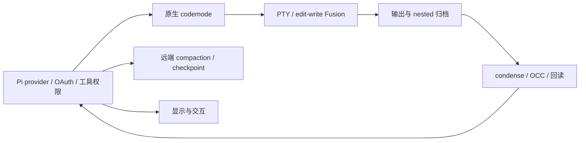

# 架构与所有权

根 `package.json` 管理依赖、入口和发布内容。Pi 加载 `extensions/*.ts`、主题与 skills；Metis 按功能持有状态和资源，Pi 持有模型、认证、工具权限及原生 codemode。

## 入口和模块

| 入口 | 实现与职责 |
| --- | --- |
| `appearance.ts` | `src/appearance/`：宿主适配、转录、输入区、状态、复制和诊断。 |
| `skill-mux.ts` / `skill-entry.ts` | `src/skills/`：多 skill 展开、补全触发和折叠，资源来源由 Pi 决定。 |
| `goal.ts` | `src/goal/`：目标状态、计时、用量、交互与续跑。 |
| `dynamic-agents.ts` | `src/dynamic-agents/`：按模型选择全局指令，按 run 发布快照。 |
| `system-prompt.ts` | 将 Pi 的 `docs` 分段指向 agent 目录中的文档指引；保留自定义完整提示。 |
| `retry-policy.ts` | 为当前会话补充瞬时计费查询故障分类；重试次数、退避和取消由 Pi 管理。 |
| `condense.ts` | `src/condense/`：原文归档、精简、恢复、摘要与 OCC。 |
| `codex-compaction.ts` | `src/remote-compaction/`：远端检查点、跨模型文字摘要及压缩请求所有权。 |
| `action-fusion.ts` | `src/execution/action-fusion.ts`：edit/write 的 `then_run`、路径队列和修改回执。 |
| `execution.ts` | `src/execution/`：PTY 进程会话、后台 shell 和资源清理。 |
| `mcp.ts` | `src/mcp/`：工具目录缓存、连接和会话租约；复用 Pi 协议、认证与 CLI。 |
| `subagents.ts` | `src/subagents/`：父会话接收、UI、Python 账本与调度、JS SDK worker。 |
| `neural-search.ts` | `src/neural-search/`：本地索引、Rust 引擎、查询、分页和文件补全。 |
| `web-access.ts` / `session-recall.ts` | `src/pi-web-access/` / `src/pi-session-recall/`：网页访问与会话检索，使用 deferred 聚合工具。 |
| `ask-user-question.ts` | `src/ask-user-question/`：结构化决策与问卷。 |
| `lsp.ts` | `src/pi-lsp/`：语言服务器路由、诊断和单文件 source actions。 |
| `config.ts` | 全局配置路径和初始化命令。 |

配置归属与入口开关见 [配置参考](configuration.md)。`configuration/store.ts` 负责加锁、合并和原子写入；各功能负责字段校验与生效策略。

## 显示数据流

宿主事件 → 功能状态与度量 → 当前快照 → 组件渲染。

- `appearance/` 持有主会话生命周期和宿主组件适配；未知宿主形状或第三方接管时退避。
- `presentation/` 提供主转录与子代理共用的工具行、Diff、Shell、思考和预览组件。
- `file-changes/` 持有文件快照与修改证据；显示观察与执行回执分别由调用者管理。
- `src/selection-copy/` 使用已提交帧的来源映射提取逻辑文本，未知区域回退原生提取。
- 界面计时、Git 轮询与用量采样各有生命周期；动画帧不扫描历史、读取磁盘或查询额度。

显示只改变呈现副本，保留工具执行、存储结果、图片和模型正文。组件包装按所有权释放；会话切换先使晚到任务失效，再绑定新上下文。

## 执行与上下文

- **执行**：原生 helper 持有进程输出、退出和关闭状态；TS manager 负责等待、交付和展示。归档记录不完整时保留原因和真实退出码。
- **精简**：原文、候选、已发布表示分开管理。保护、错误、未完成或归档失败阻止不安全替换；Pi 提供压缩边界，OCC 与远端压缩协商同一次请求的所有权。详见 [condense](features/condense.md)与[远端压缩](features/codex-compaction.md)。
- **MCP**：每个服务器由会话 owner 共享连接，缓存只提供目录，调用仍经过 Pi 工具事件和权限处理。
- **网页**：provider adapter 持有协议与计费差异；显式 transport 统一代理、DNS 固定和 SSRF 检查，不改写全局 fetch。Curator 持有自身页面、Cookie 和资源。
- **子代理**：Runtime 推进任务，worker 执行每次 run；账本、结果和父会话接收票据负责断线恢复与交付确认。前端断开不等于任务终止，见[生命周期](subagents/lifecycle.md)。

跨扩展事件与压缩协作合同归 `src/collaboration.ts`。源码模块细分见 [子代理目录说明](../src/subagents/README.md)。

## 生命周期与交付

配置、恢复证据与显示缓存的寿命独立：丢弃显示缓存不删除 blobs，卸载显示层不停止领域任务。取消、锁、提交和关闭由各功能 owner 负责。

发布包含运行时 TS、预构建 Web bundle、子代理核心、原生资产、主题、skills 和许可。原生源码、构建工具和测试留在 Git；安装使用随包资产。流程见[开发说明](development.md)，许可见[执行来源](provenance/execution/README.md)和根 [NOTICE](../NOTICE)。
